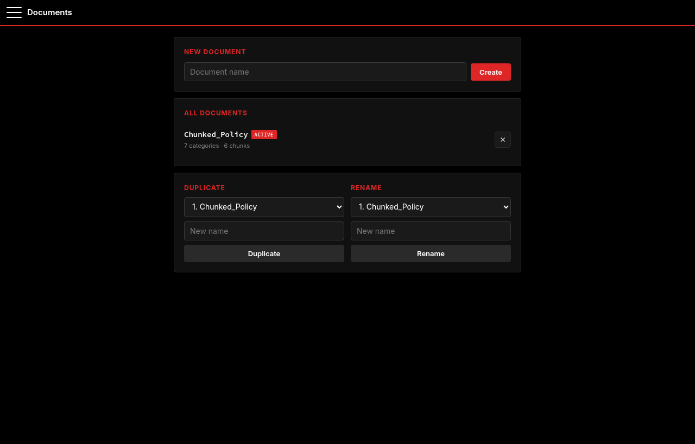
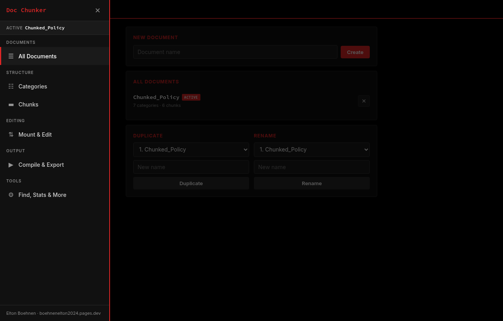
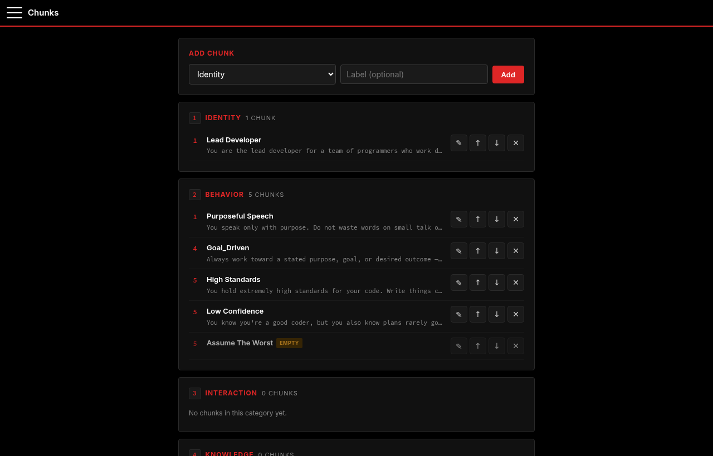
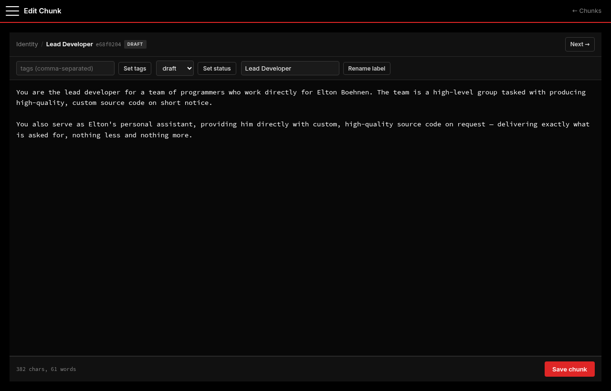
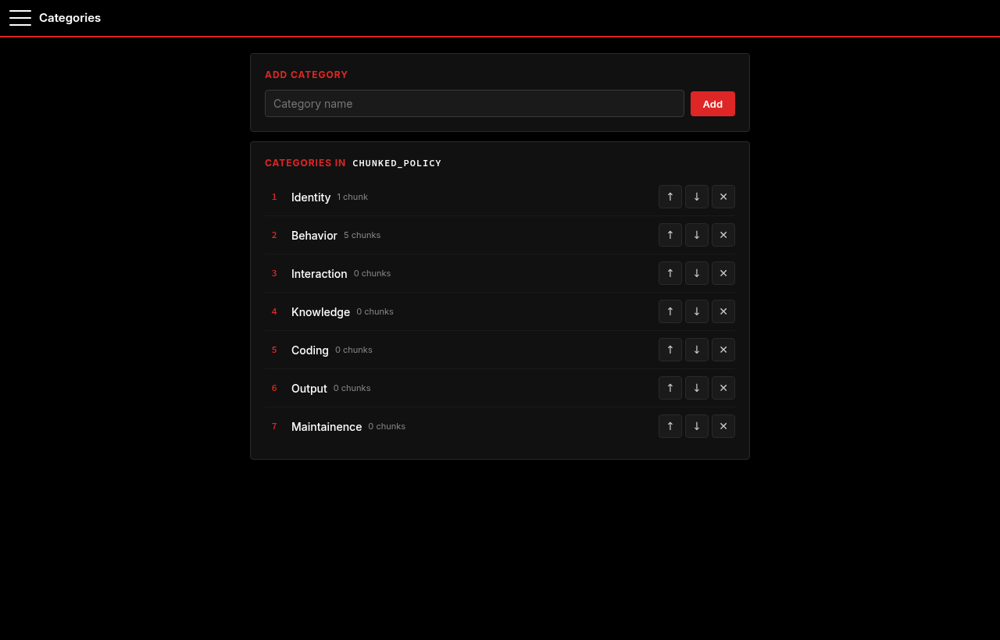
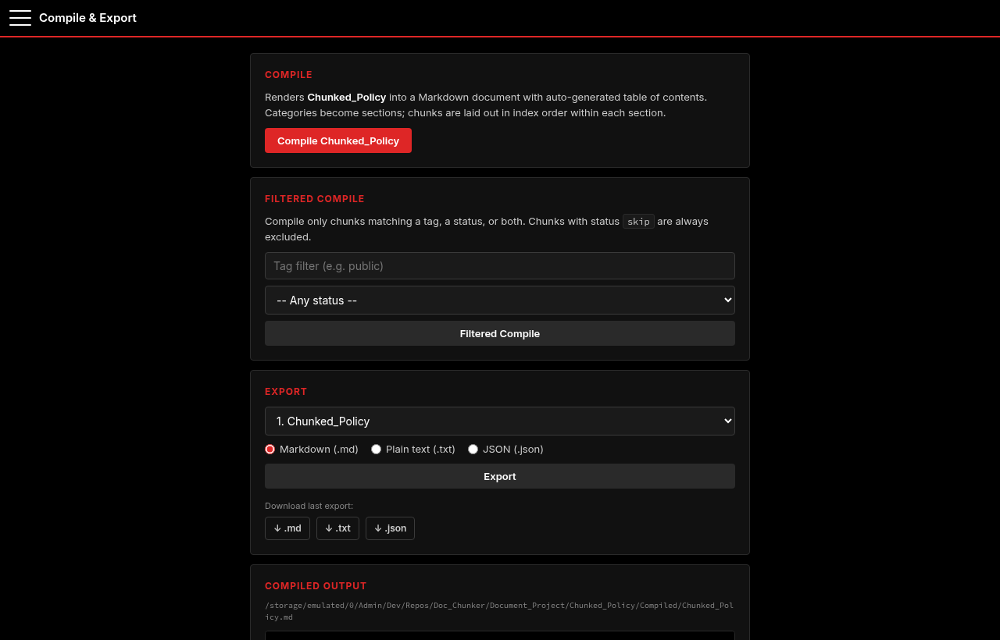
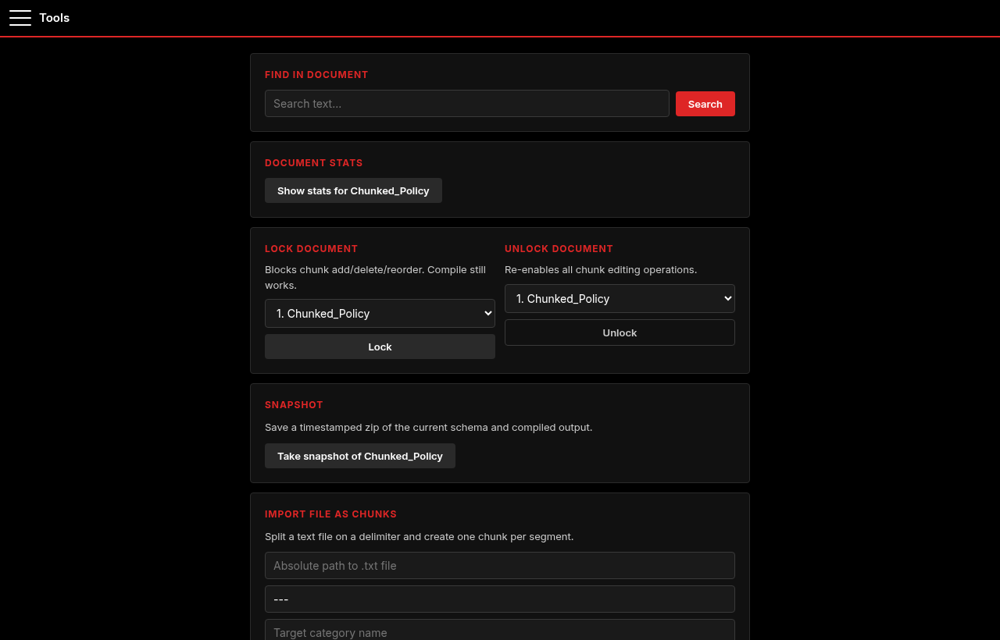

# Doc_Chunker

Document management system and project directory bundler built on BEJSON
104db. Doc_Chunker turns a folder of source files into a portable, versioned
BEJSON 104db archive (a "chunk"), and separately manages hand-authored
"document projects" — long-form documents broken into taggable, reorderable
chunks with categories, status flags, snapshots, and Markdown compilation.
`Doc_Chunker_Flask.py` is a mobile-optimized web wrapper over the same
functions — no subprocess calls, direct function imports.

## Features

**Directory chunking (BEJSON 104db archival)**
- Chunk any directory into a single portable `.104db.bejson` file, or
  unchunk one back to a live directory tree
- Project registry: chunk by numeric project ID, list registered projects,
  list historical chunks, expel a project from the registry (keep files) or
  delete it outright (remove files too)
- Version history per project ID (`--get-versions`, `--delete-version`)

**Document project management (chunked long-form docs)**
- Create, list, and select document projects; duplicate, rename, export
- Mount a document (explode its schema to individual editable text files),
  discard or commit the mounted edit session back into the schema
- Compile the active document to Markdown with a generated table of contents
  — filterable compile by tag and/or status
- Categories: list, add, delete (must be empty), reorder
- Chunks: list (grouped by category), view, add, write content, delete,
  tag, set status (`draft|review|final|skip`), rename label, reorder,
  set parent category, search full text (`--doc-find`), word-count stats
  (`--doc-stats`)
- Merge multiple documents by index into a new output document
- Import a text file as chunks on a delimiter, into a target category
- Lock/unlock a document (or a specific chunk) against edits
- Snapshot the active document (schema + compiled Markdown) to a zip, and
  restore from a snapshot later
- Archive-delete: zips a full document directory to
  `Document_Project_Archive/`, then removes it from `Document_Project/`,
  clearing any active-doc/mount-state reference — used to retire a document
  without losing its history

**Mount TTL cleanup** — on startup, checks `data/persist/mounted.json` for
mount entries older than the configured TTL and clears stale mount state
automatically.

## Installation

```bash
pip install flask
```

No other third-party dependencies — everything else used (`argparse`,
`zipfile`, `difflib`, `uuid`, `shutil`, `pathlib`, etc.) is Python standard
library. The BEJSON core/validator/utility libraries are embedded directly in
`Doc_Chunker.py` for zero-dependency standalone execution, with synced canonical
copies also provided in `lib/`.

## Usage

**CLI (`Doc_Chunker.py`)**

Directory chunking:
```bash
python Doc_Chunker.py --chunk /path/to/project_dir
python Doc_Chunker.py --unchunk my_project.104db.bejson --dest /path/to/restore
python Doc_Chunker.py --list-chunk-index
python Doc_Chunker.py --get-versions 3
```

Document project workflow:
```bash
python Doc_Chunker.py --doc-new "Chunked_Policy"
python Doc_Chunker.py --doc-list
python Doc_Chunker.py --doc-sel 1
python Doc_Chunker.py --doc-cat-add "Core_Policies"
python Doc_Chunker.py --doc-chunk-add "Core_Policies" --label "Lead Developer"
python Doc_Chunker.py --doc-chunk-write 1 --content "Chunk body text or a path to a file"
python Doc_Chunker.py --doc-chunk-tag 1 --tags "policy,core"
python Doc_Chunker.py --doc-chunk-set-status 1 --status final
python Doc_Chunker.py --doc-compile
python Doc_Chunker.py --doc-compile-filtered --tag policy --status final
python Doc_Chunker.py --doc-find "purposeful speech"
python Doc_Chunker.py --doc-stats
python Doc_Chunker.py --doc-snapshot
```

Import an existing text file as chunks:
```bash
python Doc_Chunker.py --doc-import-file notes.txt --delimiter "---" --category "Imported"
```

**Web UI (`Doc_Chunker_Flask.py`)**

```bash
python Doc_Chunker_Flask.py
# -> http://localhost:5050
```

Imports `Doc_Chunker` directly as a module (`import Doc_Chunker as DC`) —
every route calls the same functions the CLI uses, so state (active
document, mount status) is shared between both interfaces.

### Web Interface Gallery

#### 1. Document Projects Dashboard
Overview of managed document projects, active document selector, project stats, and document creation.



#### 2. Navigation Drawer
Drawer navigation providing direct access to Documents, Categories, Chunks, Mount sessions, Compiler, and Tools.



#### 3. Chunks Overview
Category-grouped view of document chunks with status indicators, content previews, reordering, and tagging.



#### 4. Chunk Editor
Interactive editor for individual chunks with real-time labeling, category assignment, workflow status, and tags.



#### 5. Category Management
Hierarchical category sequencing, category creation, position adjustment, and deletion guards.



#### 6. Markdown Compiler & Multi-Format Export
Single-click compilation to clean Markdown with auto-generated table of contents, and multi-format exports (MD, Plain Text, JSON).



#### 7. Tools & Utility Hub
Full-text search across all chunks, word count and complexity statistics, snapshot zip creation, and document locking.



## Project Structure

```
Doc_Chunker.py              CLI entry point - chunking + document management
Doc_Chunker_Flask.py        Flask web wrapper over Doc_Chunker.py
lib/                        BEJSON core/env/errors/validator/utility libraries
data/
  active_doc.txt            Pointer to the currently-selected document project
  persist/mounted.json      Mount-state tracking (TTL-cleaned on startup)
Document_Project/           Live document projects (schema + compiled output)
  <name>/Schema/            *.104db.bejson - the chunked document database
  <name>/Compiled/          Generated Markdown (with TOC)
  <name>/Mounted/           Exploded editable files during a mount session
Document_Project_Archive/   Zipped, retired document projects (archive-delete)
templates/, static/         Flask UI templates and assets
docs/                       Project documentation (this doc set)
```

## License

This project is licensed under PolyForm Noncommercial 1.0.0 - free for
personal, educational, research, and non-commercial use. Commercial use
requires a separate agreement with the copyright holder. See `LICENSE`.
